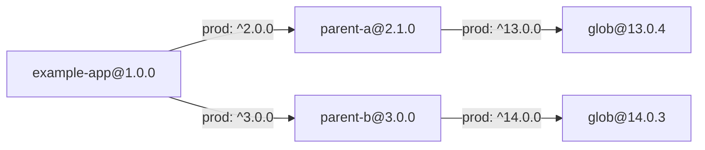

# npm Dependency Visualizer

Status: Draft.

## 1. Scope and usage

### Goal

Given a local `package.json` and `package-lock.json`, generate a dependency graph as a Markdown document containing a Mermaid diagram.
Show the requested dependency specification on each edge and the selected version from the lockfile on each package node.

The audience is developers investigating a project's resolved dependencies.
The initial experience is a CLI and a generated document, not a website.
The visual model follows DependencyVisualizer: project/package nodes, resolved versions on nodes, and requested ranges on arrows.

### MVP scope

- Read local files only, without requiring an installation or `node_modules`.
- Support lockfile versions 2 and 3, rejecting version 1 with an actionable error.
- Generate the root package's production dependency graph by default.
- Offer an option to include development dependencies.
- Include reachable optional and peer dependency relationships, distinguishing their types.
- Preserve separate installed instances, even when their names and versions match.
- Generate the complete graph by default, with optional depth filtering and package-focus highlighting or filtering.
- Write Markdown only; there is no output-format option.
- Perform no network requests, package installation, or lifecycle script execution.
- Do not modify the input files.

### Workspaces

When the root declares npm workspaces, include workspace projects by default.
A workspace is a lockfile project record whose location matches the root's `workspaces` patterns.
A dependency that resolves to a `link: true` record whose `resolved` target is a workspace points to a workspace node, and traversal continues from that workspace's lockfile record.
Without `--include-dev`, only workspaces reachable through declared dependencies appear; the root does not receive synthetic edges to every workspace.
With `--include-dev` from the root, every declared workspace is an additional traversal entry point, because npm installs every workspace's development dependencies. Workspaces that no declaration reaches appear as separate entry nodes without incoming edges; still no synthetic root edges are added.
Report how many declared workspace projects are reached, or that all of them are entry points.
`--workspace <name>` starts the graph at one workspace, identified by package name or lockfile location, instead of the root. With `--include-dev`, it follows development dependencies of that workspace and of workspaces it reaches, not of every workspace.
`--no-workspaces` restores the root-only behavior: workspace project nodes, workspace links, and traversal through those links are excluded and reported in both stderr and the generated document.

Non-workspace local links, such as `file:` directory dependencies, are not supported and remain excluded boundaries in every mode.

### Non-goals

The MVP does not render HTML, SVG, or PNG; host a website; fetch GitHub inputs; query a registry; audit vulnerabilities; compare lockfiles; modify dependencies; or recommend upgrade chains.
It does not visualize the physical contents of an existing `node_modules` directory.
Optional registry access is a future extension, not an MVP command-line switch.
Other package managers' lockfiles, npm shrinkwrap files, and non-workspace local-directory links are outside the initial support contract.
The tool does not read workspace `package.json` files; workspace declarations come from the lockfile.

### Proposed CLI

`npm-dependency-visualizer` is a working command name.

```powershell
# Read the two files from the current directory; write Markdown to stdout.
npm-dependency-visualizer

# Read files from a project directory and write a report.
npm-dependency-visualizer C:\src\project --output graph.md

# Include root development dependencies and their reachable dependencies.
npm-dependency-visualizer C:\src\project --include-dev --output graph.md

# Show the root, direct dependencies, and their immediate dependencies.
npm-dependency-visualizer C:\src\project --depth 2 --output overview.md

# Highlight every matching instance and its ancestor paths, keeping the full graph.
npm-dependency-visualizer C:\src\project --focus glob --output glob.md

# Keep only matching instances and their ancestor context.
npm-dependency-visualizer C:\src\project --focus glob --focus-mode filter --output glob-filtered.md

# Start the graph at one workspace.
npm-dependency-visualizer C:\src\project --workspace @npmcli/arborist --output arborist.md

# Visualize only the root graph, excluding workspaces.
npm-dependency-visualizer C:\src\project --no-workspaces --output root-only.md
```

The positional directory defaults to the current directory.
Both input files must be present in that directory.
Arbitrarily named or independently located input files are outside the initial CLI contract.

| Option | Meaning | Default |
| --- | --- | --- |
| `--output <file>` | Write the result to this file instead of stdout | stdout |
| `--include-dev` | Include development dependencies of the root and of every workspace (or, with `--workspace`, of the selected and reached workspaces) | Off |
| `--depth <n>` | Maximum dependency-edge distance from the start node; nonnegative integer | Unlimited |
| `--workspace <name>` | Start at the workspace with this package name or lockfile location | Root |
| `--no-workspaces` | Exclude workspaces and visualize only the root graph; incompatible with `--workspace` | Workspaces included |
| `--focus <name>` | Highlight instances with this exact declared dependency name and their ancestor paths; repeat for multiple names | None |
| `--focus-mode highlight\|filter` | Keep the rest of the graph or remove unrelated branches; requires `--focus` | `highlight` |
| `--help` | Show usage | |
| `--version` | Show tool version | |

File output must not overwrite either input file, including through a filesystem alias.
Diagnostics go to stderr, not into stdout's document stream.
An explicitly specified existing output file may be replaced by a complete normal or diagnostic report.
An invocation that fails before producing a complete report must preserve any existing output file.

## 2. Graph and output behavior

### Nodes and edges

A node represents the root project, a workspace project, or a locked package instance.
Workspace nodes use the Mermaid subroutine shape and a `(workspace)` label suffix, so they are distinguishable without color.
The start node is the root, or the selected workspace with `--workspace`; "root" in depth and focus rules means the start node.
Identify package instances by their lockfile locations, not just `name@version`.
For example, two installations of `shared@2.3.1` remain separate nodes if they occupy different locations.

Each package label contains its name and selected version.
If labels would otherwise be identical, append the lockfile-relative location to distinguish the instances.
The report's node index lists every displayed node's location.
If a version is not recorded, show `version not recorded`; do not invent one.
If the root name is absent, use the fixed label `root project` rather than a machine-specific directory name.

An arrow goes from the package declaring a dependency to the package instance resolved for that dependency in the lockfile.
Its label contains the original requested specification, for example `^13.0.0`, and the dependency type.
Preserve non-semver specs such as aliases, Git references, and tarball references rather than converting them into ranges.
For aliases, identify both the declared dependency name and the actual package name when the latter is recorded.
If an alias's actual package name is not recorded, derive it only from an unambiguous alias specification or label it `package name not recorded`.

The graph represents dependency relationships, not directory nesting.
A package hoisted into the root's `node_modules` is not necessarily a direct dependency of the root.
Several parents may point at one instance.

Cycles and shared dependencies are valid graph structures: emit each node once and retain the relationships without recursively duplicating nodes.

### Dependency selection

Start at the root and follow production, optional, and peer dependency edges.
Include only reachable instances; do not emit every entry in the lockfile.
`--include-dev` additionally admits development dependency edges of the root and of every included workspace, and their reachable dependency graphs.
It does not add published dependencies' own development requirements.
When the same dependency name occurs in both `dependencies` and `optionalDependencies`, treat it as optional.
When declarations give one dependency multiple applicable roles, preserve those roles without inventing separate installed instances.
Resolve each applicable role independently and emit a separate edge for each role/specification.
Ordinary and peer roles may therefore point to different existing instances; a missing role-specific target gets its own placeholder.

An instance reachable through both production and development paths remains visible without `--include-dev`.
Selection is based on relationships and reachability, not solely on a package-level development flag.

This is the graph recorded by the lockfile, not a claim that every optional package would be installed on the current operating system or architecture.
Bundled packages with recorded dependency metadata are handled like other locked instances.
Do not invent internal dependency edges when a bundled package's metadata is incomplete.

### Focus and depth

Apply dependency-type selection and workspace/link exclusions before view filters.

With `--focus <name>`, match every reachable instance with that exact declared dependency name, including aliases.
Repeat `--focus` to combine the matching instances and ancestor paths for multiple names; repeated names do not duplicate matches.
Compute the root, matching instances, and their ancestors: the reverse-reachable dependency subgraph that leads to the matches.
Highlight matching nodes, ancestor nodes, and relationships whose endpoints both belong to this subgraph.
Use the Sunset Boulevard palette: coral (`#f4a261`) for matches, warm sand (`#e9c46a`) for ancestors, burnt orange (`#e76f51`) for path edges, and dark contrast (`#264653`) for highlighted node text and borders.
Matching nodes have thicker borders, and highlighted edges are thicker than ordinary edges.
Identify matches and ancestors in the node index and explain styling in the legend so color is not the only signal.
Use DejaVu Sans for highlighted node text when available, falling back to the viewer's fonts.
By default, keep the rest of the graph with its normal styling (`--focus-mode highlight`).
With `--focus-mode filter`, keep only the computed subgraph and omit unrelated descendants and branches.
Without focus, keep the complete selected graph without highlighting.
Use graph traversal with visited sets, not enumeration of every possible path.

With `--depth <n>`, retain nodes whose shortest dependency-edge distance from the root is at most `n` within the selected graph.
The root has depth zero.
Keep relationships whose endpoints both survive the filters.

If focus and depth are supplied, compute focus first, optionally filter to its subgraph, and apply depth second.
A matching package may therefore be outside the displayed depth; report that explicitly.
Visible ancestors and their relationships can remain highlighted even when a matching instance is outside the depth limit.
Any requested focus name with no reachable matches is a command error, even if other requested names match.
Unresolved dependency placeholders participate in focus and depth selection using their declared names and parent relationships.

Report the active filters and the number of omitted nodes and relationships relative to the selected root graph before view filtering.
Report excluded workspace/link boundaries separately; do not claim to count dependency graphs that were not traversed.
Do not silently truncate large graphs.
Mermaid generation and successful rendering by a particular Markdown viewer are separate concerns.

### Markdown document

The default report contains:

1. A title naming the start project (the root, or the workspace selected with `--workspace`).
2. Relative input filenames, lockfile version, dependency selection, and filters.
3. Displayed node/edge counts and omission/exclusion counts.
4. Warnings about missing information or excluded workspace content, if any.
5. A legend explaining arrow direction, edge types, and selected versions.
6. One fenced `mermaid` block using a left-to-right flowchart.
7. A node index mapping diagram IDs to names, selected versions, and locations.

Output must be deterministic for identical inputs and options, including node IDs, ordering, and line endings.
Do not include generation timestamps or absolute machine-specific paths.

The Mermaid block contains only the diagram; summary, filter, and warning information appear in the surrounding Markdown.

### Illustrative graph

This is a fictional example, not a snapshot of npm/cli.
It illustrates how a developer can see two parents requesting different major versions.



The MVP displays these facts; it does not calculate which parent releases would permit moving all instances to a particular version.

### Incomplete or inconsistent inputs

Malformed input, missing input files, unsupported lockfile versions, and inconsistent root dependency declarations are errors.
Never silently regenerate the lockfile or select replacement versions.

For readable lockfiles with unresolved required dependencies, preserve the available evidence and report the problem in the document and stderr.
An unresolved dependency uses a placeholder node marked `unresolved`, never a fabricated selected version.
An absent optional dependency or optional peer is labeled `not recorded (optional)`, not asserted to be an invalid installation.
Absent dependency maps are treated as empty, since a package may legitimately have no dependencies.
If the lockfile omits internal package metadata, the tool cannot independently detect or reconstruct unrecorded dependencies.

The MVP reports declared specifications and locked resolutions, not a complete npm installation-validity verdict.
Do not label an edge invalid merely because its selected version falls outside its original range: root overrides may explain that selection.
When the root declares `overrides`, state that overrides are present and that displayed edge labels are the original declarations, not computed effective override specifications.
Do not infer transitive override rules from selected versions.

Workspace and link exclusions are intentional omissions, not unresolved-package errors.
If a dependency resolves to an excluded link, identify that dependency and the exclusion rather than drawing a misleading replacement.
A link whose target is not a recorded workspace project, including any local-directory link, is excluded using this rule.

## 3. Technical approach

### Implementation shape

Implement a Node.js CLI with a direct reader for `package-lock.json`.
Do not require Arborist for the MVP.
The lockfile is the source of selected package instances and transitive dependency declarations.
The root `package.json` supplies the project's declarations and is checked against the lockfile's root record.

Separate input validation, graph construction, graph selection, and output formatting.
Keep the graph model independent of Mermaid so that a later HTML viewer can consume the same data without changing resolution behavior.
No database, backend service, registry client, or browser runtime is required to generate a document.

### Input validation

Read both JSON files and validate their top-level shapes before constructing the graph.
Require `lockfileVersion` to be 2 or 3 and require a `packages` object containing the root entry `""`.
For v2 lockfiles, use `packages` as authoritative and do not also traverse the legacy top-level `dependencies` tree.
Compare root `dependencies`, `devDependencies`, `optionalDependencies`, `peerDependencies`, and `peerDependenciesMeta`, treating absent maps as empty and ignoring object-key order.
Before comparing dependency maps, remove each production declaration whose name also occurs in the same file's optional dependency map.
Thus, a shadowed production declaration does not cause a mismatch when the effective optional declarations agree.
Report differing declaration names/specifications and stop when these root dependency declarations disagree.
Do not require optional project metadata such as name or version to be present in both files.

Keep lockfile locations as logical, slash-separated keys independently of the host operating system.
Use platform-native paths only to open input and output files.
Do not follow locations or dependency specifications onto the filesystem.

### Graph construction

Index the root and supported package records by their exact lockfile location.
Derive an instance's declared installation name from its location, preserving scoped names.
Use a package record's `name` for its actual package identity when present.
Read selected versions only from the corresponding records, not from dependency ranges.

For ordinary and optional dependencies, search for `<requester>/node_modules/<dependency-name>` first, then the equivalent locations in each enclosing package scope up to the root.
For peers declared by a non-project package, start in its enclosing package scope rather than its private `node_modules`.
For peers declared by the root or a workspace, start in that project's own `node_modules`.
A workspace's enclosing scope is the root.
Select the first recorded candidate at the appropriate location; never search globally by name or choose the highest matching version.
An occupied candidate that is an excluded link stops that lookup; do not skip it and resolve a different package farther up.
If a peer is recorded only in the declaring package's private `node_modules`, report unsupported peer placement rather than presenting it as a valid peer resolution.
In that case, emit an unresolved peer placeholder and identify the private candidate in its diagnostic.
Do not traverse that private candidate through the peer edge; include it only if another supported relationship independently reaches it.

Read workspace patterns from the root manifest's `workspaces` array or `workspaces.packages` array, falling back to the lockfile root record.
Match logical locations against the patterns with `*` and `?` within one path segment and `**` across segments; a leading `!` excludes matches.
A workspace is a project record (a location without a `node_modules` segment) matching those patterns.
When a resolved candidate is a `link: true` record whose `resolved` location is a workspace, the edge targets the workspace node keyed by that location.
Several links to one workspace share its node.
Any other link record, or every link with `--no-workspaces`, is an excluded boundary: do not traverse it or load its target.
Never read workspace files from disk.
With `--no-workspaces`, packages used by both the root graph and workspace graphs remain included when independently reachable without crossing an excluded boundary.
Unreachable lockfile records, including unreached workspaces when development dependencies are disabled, are not part of the graph.
When development dependencies are enabled and traversal starts at the root, seed traversal with the root followed by every workspace in sorted location order; depth limits measure distance from the nearest entry point.
Report project records that are not included workspaces as excluded project records.

Read dependency roles from `dependencies`, `optionalDependencies`, `peerDependencies`, and `peerDependenciesMeta`.
Use `devDependencies` only from the root and from workspaces, and only when development dependencies are enabled.
Create a separate unresolved placeholder for each missing parent/name/role relationship so unrelated missing requirements cannot be accidentally merged.
Preserve the original declaration and selected instance even when the tool cannot validate their compatibility.

### Internal model

| Record | Required data |
| --- | --- |
| Project | Name, optional version, lockfile version, root node ID, input filenames |
| Package node | Stable identity, lockfile location, installation name, actual name if known, selected version if known |
| Placeholder node | Parent identity, declared name, role, missing/optional status |
| Dependency edge | Source ID, target ID, declared name, original specification, dependency role |
| Diagnostic | Code, severity, affected node/edge or excluded boundary, explanatory message |
| Selected view | Included nodes/edges, matched and ancestor node identities, highlighted relationships, focus mode, active filters, omission counts, exclusions, diagnostics |

Maintain outgoing and incoming adjacency indexes for reachability, reverse-focus selection, and future dependency investigations.
Use iterative traversal with visited sets so cycles and deep dependency chains cannot overflow the call stack.
View selection should take linear time in the size of the constructed graph; deterministic output sorting may take additional sorting time.
Do not enumerate root-to-target paths as a preprocessing step.

### Mermaid and Markdown writers

Assign node IDs from a stable ordering of identities, using generated identifiers such as `n0` rather than package names as Mermaid syntax.
Sort by logical lockfile location and then by explicit placeholder identity using a locale-independent ordinal comparison.
Sort edges by source identity, target identity, declared name, role, and specification.
Keep node IDs stable across view filters for the same input graph and dependency selection.
Emit fixed Mermaid classes for focus nodes and style only highlighted edges using their final emitted indices after filtering and sorting.

Quote labels and escape input text for its destination: Mermaid labels, Markdown headings, and Markdown table cells.
Handle quotes, pipes, brackets, angle brackets, ampersands, backticks, and line breaks without creating new diagram statements or closing a Markdown fence.
Do not emit executable HTML, clickable links, or Mermaid directives sourced from input values.
Use conservative flowchart syntax and verify it against the Mermaid version used by the output tests.
Document the tested Mermaid version without requiring users to install it to generate source.

Emit UTF-8 with LF line endings and a final newline.
Build and validate the entire report before writing stdout or replacing an output file.
Normal reports and exit-code-2 diagnostic reports are both complete reports eligible for writing.
Use a temporary sibling file and an atomic replacement where supported to avoid leaving a partial destination.
Remove temporary output files on failure.
An stdout write failure produces exit code `1`, but bytes already consumed by a pipe cannot be recalled.

### Diagnostics and exit codes

| Exit code | Meaning | Report produced |
| --- | --- | --- |
| `0` | Supported graph generated, possibly with explicitly documented optional omissions or workspace/link exclusions | Yes |
| `1` | Invalid arguments/input, inconsistent root declarations, unmatched focus, or output failure | No intentional report; stdout may be partial on a write failure |
| `2` | Diagnostic report generated with unresolved required dependencies, missing non-root versions, or unsupported peer placement | Yes |

Known unsupported workspace/link exclusions remain warnings rather than exit-code-2 graph defects.
Missing versions or unsupported peer placement on included non-root records produce exit code `2`.
These and unresolved required targets are the detectable graph defects covered by exit code `2`; absent dependency maps alone are not defects.
Absence of optional dependencies or optional peers alone does not produce exit code `2`.
Validate the whole dependency-selected root graph before view filtering so a depth or focus filter does not hide an exit-code-2 defect.
For a valid dependency-free project, emit a root-only graph with exit code `0`.
Diagnostics must identify the affected logical location and declared dependency without exposing absolute local paths in the report.

## 4. Acceptance tests and future work

### Focused acceptance tests

| Scenario | Expected result |
| --- | --- |
| Direct and transitive dependencies | Every included node shows its locked version and every edge shows its declared specification and role |
| Hoisted transitive package | The declaring parent points to the hoisted instance without creating a false root dependency |
| Nested conflicting versions | Each parent points to the correct location-specific instance |
| Duplicate name and version at different locations | Instances remain distinct and their visible labels are disambiguated |
| Shared production/development dependency | Default output retains the production-reachable instance and omits the development-only root edge |
| `--include-dev` | Root development dependencies and their reachable dependencies appear without adding transitive development requirements |
| Optional dependencies and optional peers | Recorded instances appear; absent instances are explicitly optional placeholders |
| Peer placement | Peers resolve from the proper enclosing scope; unsupported private placement creates an unresolved peer placeholder without traversing that private target |
| Multiple dependency roles | Ordinary and peer roles resolve independently, with distinct edges to the appropriate recorded instances or placeholders |
| Scoped package and alias | Names remain intact and alias requirements point to the correct installation location |
| Git or tarball specification | Original specification is preserved without registry access or conversion into a range |
| Root overrides | Original edge declarations remain visible and an override notice prevents a false compatibility claim |
| Cycle and shared subgraph | Generation terminates, nodes are emitted once, and relationships remain present |
| Depth zero and depth two | Output uses shortest root distance, with exact omission counts |
| Focus highlighting with multiple versions | Every matching reachable instance and its ancestor context are colored while unrelated branches remain unchanged |
| Focus filter mode | Only matching reachable instances and their ancestors appear, using the same focus colors |
| Focus edge styles | Only ancestor-subgraph edges are colored, with correct indices after filtering and sorting |
| Combined focus and depth | Focus is evaluated first and depth-hidden matches are reported |
| Missing focus name | Exit code `1`, actionable stderr, and no document written |
| v2 and v3 equivalent fixtures | Equivalent logical graphs without duplicate traversal of the v2 legacy tree |
| v1 or unknown lockfile version | Exit code `1` and an unsupported-version diagnostic |
| Stale root declarations | Exit code `1` identifies mismatched effective declarations, ignoring production declarations shadowed by optional declarations |
| Missing required record/version | Diagnostic report uses explicit unknowns and exit code `2`, without invented versions or edges |
| Excluded local link or `--no-workspaces` | No target traversal, named exclusions, and no fallback to another same-name instance |
| Workspace traversal | Links to workspaces point to one workspace node per project, workspace dependencies resolve from the workspace's own `node_modules` and then the root, and unreached workspaces are counted |
| Workspace development dependencies | `--include-dev` follows root and every workspace's development dependencies, including workspaces no declaration reaches, without synthetic root edges, and not those of published packages |
| `--workspace <name>` | The graph starts at the named workspace; an unknown name or combination with `--no-workspaces` is exit code `1` |
| Dependency-free project | Root-only diagram, empty dependency list, and exit code `0` |
| Escaping and reserved Mermaid tokens | Markdown stays structurally valid and the extracted Mermaid block passes the parser |
| Reordered JSON keys and repeated runs | Byte-identical documents for equivalent input objects and options |
| Windows and a non-Windows host | Equivalent graph identities and output bytes despite different filesystem path separators |
| Existing `node_modules` or unrelated workspace files | Same result as an input-only directory |
| Offline execution | Succeeds with outbound access blocked and no child process, cache modification, or input modification |
| Output protection and write failure | Exit code `1` preserves inputs and prior file output without leaked temporary files; stdout write failures may leave already-written bytes |
| Diagnostic file output | Exit code `2` writes the complete diagnostic report and may replace the explicitly selected existing output file |

Use small committed fixtures for these cases and parser-based tests for generated Mermaid.
Test Markdown output, including stderr separation and exit codes.
Pin the Mermaid test dependency rather than relying on an external rendering service.
Representative small diagrams must also be visually checked in a documented Mermaid-capable Markdown viewer.

### npm/cli representative case

Prepare a fixture from the root `package.json` and `package-lock.json` at the same pinned npm/cli commit.
Record the commit SHA with the fixture; do not download the mutable `latest` branch during test execution.
Confirm the chosen revision uses a supported lockfile version.

Generate the default production graph and a focused graph for a package present in the pinned input, such as `glob`.
Verify a known root dependency and a known transitive dependency against their exact lockfile records.
Assert that workspaces linked by root dependencies are traversed by default, and that with `--no-workspaces` workspace projects and links are excluded with clear warnings while independently reachable root dependencies remain present.
Manually audit expected node/edge counts for the pinned fixture rather than deriving the test oracle using the production graph builder.
Require deterministic generation and no implicit size-based truncation.

The full npm/cli diagram is a generation and correctness test, not a promise that every Markdown host can lay out a graph of that size.
Document the tested host and use depth or focus filter mode to demonstrate a readable view if the full diagram exceeds that host's renderer limits.

### Delivery sequence

1. Implement validated v2/v3 input reading and location-aware graph construction, with resolution fixtures.
2. Add deterministic Markdown/Mermaid writers and parser-based output tests.
3. Add development inclusion, depth/focus filtering, and omission diagnostics.
4. Validate the pinned npm/cli root case and document CLI usage and rendering limitations.

### Future work

Selecting several workspaces at once and traversing non-workspace local-directory links can extend workspace support.
An interactive HTML or website view can reuse the graph model for search, expansion, and reverse-dependency exploration.
GitHub input loading and optional registry access can be separate adapters rather than prerequisites for local visualization.

Upgrade analysis is a separate capability.
For a request such as moving a package from `13.0.4` to `14.0.3`, distinguish showing current parent chains from finding parent releases that permit the target version.
The latter requires additional release metadata and npm constraint analysis; the current lockfile alone does not establish a valid upgrade plan.
Do not claim that every ancestor needs updating, or that satisfying one declared range proves the entire proposed installation is valid.
If registry-backed planning is added, make network use explicit and keep the original offline graph workflow unchanged.

### Research references

- Inspiration: `https://github.com/nkolev92/DependencyVisualizer`
- Representative root manifest: `https://github.com/npm/cli/blob/latest/package.json`
- Matching lockfile: `https://github.com/npm/cli/blob/latest/package-lock.json`
- Lockfile format: `https://docs.npmjs.com/cli/v11/configuring-npm/package-lock-json/`
- Dependency declarations and overrides: `https://docs.npmjs.com/cli/v11/configuring-npm/package-json/`
- npm dependency graph model: `https://github.com/npm/cli/blob/latest/workspaces/arborist/README.md`
- Mermaid flowchart syntax: `https://mermaid.js.org/syntax/flowchart.html`
