# Dependency graph: &#64;npmcli/arborist

- Inputs: package.json, package-lock.json; lockfile version 3.
- Dependency selection: production, optional, and peer dependencies.
- Filters: focus none; depth unlimited.
- Displayed: 118 nodes, 227 relationships.
- Omitted by filters: 0 nodes, 0 relationships.
- Excluded boundaries: 0 relationships; excluded non-node&#95;modules project records: 0.
- Workspaces: included; reached 1 of 16 workspace projects.
- Start node: workspace &#64;npmcli/arborist at workspaces/arborist.

## Warnings

- optional-not-recorded: node&#95;modules/proxy-agent-negotiate declares optional peer dependency kerberos (^2.0.0), but no eligible package is recorded.

## Legend

- Arrows point from the declaring package to its resolved dependency.
- Node versions are selected versions; edge labels show the dependency role, declared name, and original specification.
- `prod`, `dev`, `optional`, `peer`, and `optional peer` identify dependency roles.
- Unresolved and unrecorded optional dependencies have placeholder nodes.
- Workspace projects use double-bordered (subroutine) nodes labeled `(workspace)`.

## Dependency graph

```mermaid
flowchart LR
    n0["@gar/promise-retry@1.0.3"]
    n1["@isaacs/fs-minipass@4.0.1"]
    n2["@isaacs/string-locale-compare@1.1.0"]
    n3["@npmcli/agent@5.0.2"]
    n4["agent-base@9.0.0 #91;node_modules/@npmcli/agent/node_modules/agent-base#93;"]
    n5["http-proxy-agent@9.1.0"]
    n6["https-proxy-agent@9.1.0"]
    n7["@npmcli/fs@6.0.0"]
    n8["@npmcli/git@8.0.0"]
    n9["@npmcli/installed-package-contents@5.0.0"]
    n10["npm-bundled@6.0.0"]
    n11["npm-normalize-package-bin@6.0.0 #91;node_modules/@npmcli/installed-package-contents/node_modules/npm-normalize-package-bin#93;"]
    n12["@npmcli/map-workspaces@6.0.0"]
    n13["@npmcli/metavuln-calculator@10.0.0"]
    n14["@npmcli/name-from-folder@5.0.0"]
    n15["@npmcli/node-gyp@6.0.0"]
    n16["@npmcli/package-json@8.0.0"]
    n17["@npmcli/promise-spawn@10.0.1"]
    n18["@npmcli/query@5.0.0"]
    n19["@npmcli/redact@5.0.0"]
    n20["@npmcli/run-script@11.0.0"]
    n21["@sigstore/bundle@5.0.0"]
    n22["@sigstore/core@4.0.1"]
    n23["@sigstore/protobuf-specs@0.5.1"]
    n24["@sigstore/sign@5.0.0"]
    n25["@sigstore/tuf@5.0.0"]
    n26["@sigstore/verify@4.1.0"]
    n27["@tufjs/canonical-json@2.0.0"]
    n28["@tufjs/models@5.0.0"]
    n29["abbrev@5.0.0"]
    n30["balanced-match@4.0.4"]
    n31["bin-links@7.0.1"]
    n32["cmd-shim@9.0.2"]
    n33["npm-normalize-package-bin@6.0.0 #91;node_modules/bin-links/node_modules/npm-normalize-package-bin#93;"]
    n34["read-cmd-shim@7.0.1"]
    n35["brace-expansion@5.0.12"]
    n36["cacache@21.0.1"]
    n37["chownr@3.0.0"]
    n38["common-ancestor-path@2.0.0"]
    n39["cssesc@3.0.0"]
    n40["debug@4.4.3"]
    n41["diff@8.0.4"]
    n42["env-paths@2.2.1"]
    n43["exponential-backoff@3.1.3"]
    n44["fs-minipass@3.0.3"]
    n45["glob@13.0.6"]
    n46["graceful-fs@4.2.11"]
    n47["hosted-git-info@10.1.1"]
    n48["http-cache-semantics@4.3.0"]
    n49["iconv-lite@0.7.3"]
    n50["ini@7.0.0"]
    n51["ip-address@10.7.5"]
    n52["isexe@4.0.0"]
    n53["json-parse-even-better-errors@6.0.0"]
    n54["json-stringify-nice@1.1.4"]
    n55["jsonparse@1.3.1"]
    n56["just-diff@6.0.2"]
    n57["just-diff-apply@5.5.0"]
    n58["lru-cache@11.5.2"]
    n59["make-fetch-happen@16.0.1"]
    n60["minimatch@10.2.5"]
    n61["minipass@7.1.3"]
    n62["minipass-collect@2.0.1"]
    n63["minipass-fetch@6.0.0"]
    n64["minipass-flush@1.0.6"]
    n65["minipass-pipeline@1.2.4"]
    n66["minipass@3.3.6"]
    n67["yallist@4.0.0"]
    n68["minipass-sized@2.0.0"]
    n69["minizlib@3.1.0"]
    n70["ms@2.1.3"]
    n71["negotiator@1.0.0"]
    n72["node-gyp@13.0.0"]
    n73["nopt@10.0.1"]
    n74["npm-install-checks@9.0.0"]
    n75["npm-package-arg@14.0.0"]
    n76["npm-packlist@11.3.0"]
    n77["ignore-walk@9.0.0"]
    n78["npm-pick-manifest@12.0.0"]
    n79["npm-normalize-package-bin@6.0.0 #91;node_modules/npm-pick-manifest/node_modules/npm-normalize-package-bin#93;"]
    n80["npm-registry-fetch@20.0.1"]
    n81["p-map@7.0.5"]
    n82["pacote@22.0.1"]
    n83["parse-conflict-json@6.0.0"]
    n84["path-scurry@2.0.2"]
    n85["postcss-selector-parser@7.1.6"]
    n86["proc-log@7.0.0"]
    n87["proggy@4.0.0"]
    n88["promise-all-reject-late@1.0.1"]
    n89["promise-call-limit@3.0.2"]
    n90["proxy-agent-negotiate@1.1.0"]
    n91["kerberos (not recorded (optional))"]
    n92["safer-buffer@2.1.2"]
    n93["semver@7.8.6"]
    n94["signal-exit@4.1.0"]
    n95["sigstore@5.0.0"]
    n96["smart-buffer@4.2.0"]
    n97["socks@2.8.9"]
    n98["socks-proxy-agent@10.1.0"]
    n99["agent-base@9.0.0 #91;node_modules/socks-proxy-agent/node_modules/agent-base#93;"]
    n100["spdx-exceptions@2.5.0"]
    n101["spdx-expression-parse@4.0.0"]
    n102["spdx-license-ids@3.0.23"]
    n103["ssri@14.0.0"]
    n104["tar@7.5.22"]
    n105["tinyglobby@0.2.17"]
    n106["fdir@6.5.0"]
    n107["picomatch@4.0.5"]
    n108["treeverse@3.0.0"]
    n109["tuf-js@6.0.0"]
    n110["undici@6.29.1"]
    n111["util-deprecate@1.0.2"]
    n112["validate-npm-package-name@8.0.0"]
    n113["walk-up-path@4.0.0"]
    n114["which@7.0.0"]
    n115["write-file-atomic@8.0.0"]
    n116["yallist@5.0.0"]
    n117[["@npmcli/arborist@10.0.4 (workspace)"]]
    n1 -->|"prod: minipass @ ^7.0.4"| n61
    n3 -->|"prod: agent-base @ ^9.0.0"| n4
    n3 -->|"prod: http-proxy-agent @ ^9.0.0"| n5
    n3 -->|"prod: https-proxy-agent @ ^9.0.0"| n6
    n3 -->|"prod: lru-cache @ ^11.2.1"| n58
    n3 -->|"prod: socks-proxy-agent @ ^10.0.0"| n98
    n5 -->|"prod: agent-base @ 9.0.0"| n4
    n5 -->|"prod: debug @ ^4.3.4"| n40
    n5 -->|"prod: proxy-agent-negotiate @ 1.1.0"| n90
    n6 -->|"prod: agent-base @ 9.0.0"| n4
    n6 -->|"prod: debug @ ^4.3.4"| n40
    n6 -->|"prod: proxy-agent-negotiate @ 1.1.0"| n90
    n7 -->|"prod: semver @ ^7.3.5"| n93
    n8 -->|"prod: @gar/promise-retry @ ^1.0.0"| n0
    n8 -->|"prod: @npmcli/promise-spawn @ ^10.0.0"| n17
    n8 -->|"prod: ini @ ^7.0.0"| n50
    n8 -->|"prod: lru-cache @ ^11.2.1"| n58
    n8 -->|"prod: npm-pick-manifest @ ^12.0.0"| n78
    n8 -->|"prod: proc-log @ ^7.0.0"| n86
    n8 -->|"prod: semver @ ^7.3.5"| n93
    n8 -->|"prod: which @ ^7.0.0"| n114
    n9 -->|"prod: npm-bundled @ ^6.0.0"| n10
    n9 -->|"prod: npm-normalize-package-bin @ ^6.0.0"| n11
    n10 -->|"prod: npm-normalize-package-bin @ ^6.0.0"| n11
    n12 -->|"prod: @npmcli/name-from-folder @ ^5.0.0"| n14
    n12 -->|"prod: @npmcli/package-json @ ^8.0.0"| n16
    n12 -->|"prod: glob @ ^13.0.0"| n45
    n12 -->|"prod: minimatch @ ^10.0.3"| n60
    n13 -->|"prod: cacache @ ^21.0.1"| n36
    n13 -->|"prod: json-parse-even-better-errors @ ^6.0.0"| n53
    n13 -->|"prod: pacote @ ^22.0.0"| n82
    n13 -->|"prod: proc-log @ ^7.0.0"| n86
    n13 -->|"prod: semver @ ^7.3.5"| n93
    n16 -->|"prod: @npmcli/git @ ^8.0.0"| n8
    n16 -->|"prod: glob @ ^13.0.0"| n45
    n16 -->|"prod: hosted-git-info @ ^10.1.1"| n47
    n16 -->|"prod: json-parse-even-better-errors @ ^6.0.0"| n53
    n16 -->|"prod: proc-log @ ^7.0.0"| n86
    n16 -->|"prod: semver @ ^7.5.3"| n93
    n16 -->|"prod: spdx-expression-parse @ ^4.0.0"| n101
    n17 -->|"prod: which @ ^7.0.0"| n114
    n18 -->|"prod: postcss-selector-parser @ ^7.0.0"| n85
    n20 -->|"prod: @npmcli/node-gyp @ ^6.0.0"| n15
    n20 -->|"prod: @npmcli/package-json @ ^8.0.0"| n16
    n20 -->|"prod: @npmcli/promise-spawn @ ^10.0.0"| n17
    n20 -->|"prod: node-gyp @ ^13.0.0"| n72
    n20 -->|"prod: proc-log @ ^7.0.0"| n86
    n21 -->|"prod: @sigstore/protobuf-specs @ ^0.5.0"| n23
    n24 -->|"prod: @gar/promise-retry @ ^1.0.2"| n0
    n24 -->|"prod: @sigstore/bundle @ ^5.0.0"| n21
    n24 -->|"prod: @sigstore/core @ ^4.0.0"| n22
    n24 -->|"prod: @sigstore/protobuf-specs @ ^0.5.0"| n23
    n24 -->|"prod: make-fetch-happen @ ^16.0.0"| n59
    n24 -->|"prod: proc-log @ ^7.0.0"| n86
    n25 -->|"prod: @sigstore/protobuf-specs @ ^0.5.0"| n23
    n25 -->|"prod: tuf-js @ ^6.0.0"| n109
    n26 -->|"prod: @sigstore/bundle @ ^5.0.0"| n21
    n26 -->|"prod: @sigstore/core @ ^4.0.1"| n22
    n26 -->|"prod: @sigstore/protobuf-specs @ ^0.5.0"| n23
    n28 -->|"prod: @tufjs/canonical-json @ 2.0.0"| n27
    n28 -->|"prod: minimatch @ ^10.2.1"| n60
    n31 -->|"prod: cmd-shim @ ^9.0.0"| n32
    n31 -->|"prod: npm-normalize-package-bin @ ^6.0.0"| n33
    n31 -->|"prod: read-cmd-shim @ ^7.0.0"| n34
    n31 -->|"prod: proc-log @ ^7.0.0"| n86
    n31 -->|"prod: write-file-atomic @ ^8.0.0"| n115
    n35 -->|"prod: balanced-match @ ^4.0.2"| n30
    n36 -->|"prod: @npmcli/fs @ ^6.0.0"| n7
    n36 -->|"prod: fs-minipass @ ^3.0.0"| n44
    n36 -->|"prod: glob @ ^13.0.0"| n45
    n36 -->|"prod: lru-cache @ ^11.1.0"| n58
    n36 -->|"prod: minipass @ ^7.0.3"| n61
    n36 -->|"prod: minipass-collect @ ^2.0.1"| n62
    n36 -->|"prod: minipass-flush @ ^1.0.5"| n64
    n36 -->|"prod: minipass-pipeline @ ^1.2.4"| n65
    n36 -->|"prod: p-map @ ^7.0.2"| n81
    n36 -->|"prod: ssri @ ^14.0.0"| n103
    n40 -->|"prod: ms @ ^2.1.3"| n70
    n44 -->|"prod: minipass @ ^7.0.3"| n61
    n45 -->|"prod: minimatch @ ^10.2.2"| n60
    n45 -->|"prod: minipass @ ^7.1.3"| n61
    n45 -->|"prod: path-scurry @ ^2.0.2"| n84
    n47 -->|"prod: lru-cache @ ^11.1.0"| n58
    n49 -->|"prod: safer-buffer @ #62;= 2.1.2 #60; 3.0.0"| n92
    n59 -->|"prod: @gar/promise-retry @ ^1.0.0"| n0
    n59 -->|"prod: @npmcli/agent @ ^5.0.0"| n3
    n59 -->|"prod: @npmcli/redact @ ^5.0.0"| n19
    n59 -->|"prod: cacache @ ^21.0.0"| n36
    n59 -->|"prod: http-cache-semantics @ ^4.1.1"| n48
    n59 -->|"prod: minipass @ ^7.0.2"| n61
    n59 -->|"prod: minipass-fetch @ ^6.0.0"| n63
    n59 -->|"prod: minipass-flush @ ^1.0.5"| n64
    n59 -->|"prod: minipass-pipeline @ ^1.2.4"| n65
    n59 -->|"prod: negotiator @ ^1.0.0"| n71
    n59 -->|"prod: proc-log @ ^7.0.0"| n86
    n59 -->|"prod: ssri @ ^14.0.0"| n103
    n60 -->|"prod: brace-expansion @ ^5.0.5"| n35
    n62 -->|"prod: minipass @ ^7.0.3"| n61
    n63 -->|"optional: iconv-lite @ ^0.7.2"| n49
    n63 -->|"prod: minipass @ ^7.0.3"| n61
    n63 -->|"prod: minipass-sized @ ^2.0.0"| n68
    n63 -->|"prod: minizlib @ ^3.0.1"| n69
    n64 -->|"prod: minipass @ ^7.1.3"| n61
    n65 -->|"prod: minipass @ ^3.0.0"| n66
    n66 -->|"prod: yallist @ ^4.0.0"| n67
    n68 -->|"prod: minipass @ ^7.1.2"| n61
    n69 -->|"prod: minipass @ ^7.1.2"| n61
    n72 -->|"prod: env-paths @ ^2.2.0"| n42
    n72 -->|"prod: exponential-backoff @ ^3.1.1"| n43
    n72 -->|"prod: graceful-fs @ ^4.2.6"| n46
    n72 -->|"prod: nopt @ ^10.0.0"| n73
    n72 -->|"prod: proc-log @ ^7.0.0"| n86
    n72 -->|"prod: semver @ ^7.3.5"| n93
    n72 -->|"prod: tar @ ^7.5.4"| n104
    n72 -->|"prod: tinyglobby @ ^0.2.12"| n105
    n72 -->|"prod: undici @ ^6.25.0"| n110
    n72 -->|"prod: which @ ^7.0.0"| n114
    n73 -->|"prod: abbrev @ ^5.0.0"| n29
    n74 -->|"prod: semver @ ^7.1.1"| n93
    n75 -->|"prod: hosted-git-info @ ^10.1.0"| n47
    n75 -->|"prod: proc-log @ ^7.0.0"| n86
    n75 -->|"prod: semver @ ^7.3.5"| n93
    n75 -->|"prod: validate-npm-package-name @ ^8.0.0"| n112
    n76 -->|"prod: glob @ ^13.0.6"| n45
    n76 -->|"prod: ignore-walk @ ^9.0.0"| n77
    n76 -->|"prod: proc-log @ ^7.0.0"| n86
    n77 -->|"prod: minimatch @ ^10.0.3"| n60
    n78 -->|"prod: npm-install-checks @ ^9.0.0"| n74
    n78 -->|"prod: npm-package-arg @ ^14.0.0"| n75
    n78 -->|"prod: npm-normalize-package-bin @ ^6.0.0"| n79
    n78 -->|"prod: semver @ ^7.3.5"| n93
    n80 -->|"prod: @npmcli/redact @ ^5.0.0"| n19
    n80 -->|"prod: jsonparse @ ^1.3.1"| n55
    n80 -->|"prod: make-fetch-happen @ ^16.0.0"| n59
    n80 -->|"prod: minipass @ ^7.0.2"| n61
    n80 -->|"prod: minipass-fetch @ ^6.0.0"| n63
    n80 -->|"prod: minizlib @ ^3.0.1"| n69
    n80 -->|"prod: npm-package-arg @ ^14.0.0"| n75
    n80 -->|"prod: proc-log @ ^7.0.0"| n86
    n82 -->|"prod: @gar/promise-retry @ ^1.0.0"| n0
    n82 -->|"prod: @npmcli/git @ ^8.0.0"| n8
    n82 -->|"prod: @npmcli/installed-package-contents @ ^5.0.0"| n9
    n82 -->|"prod: @npmcli/package-json @ ^8.0.0"| n16
    n82 -->|"prod: @npmcli/promise-spawn @ ^10.0.0"| n17
    n82 -->|"prod: @npmcli/run-script @ ^11.0.0"| n20
    n82 -->|"prod: cacache @ ^21.0.1"| n36
    n82 -->|"prod: fs-minipass @ ^3.0.0"| n44
    n82 -->|"prod: minipass @ ^7.0.2"| n61
    n82 -->|"prod: npm-package-arg @ ^14.0.0"| n75
    n82 -->|"prod: npm-packlist @ ^11.2.0"| n76
    n82 -->|"prod: npm-pick-manifest @ ^12.0.0"| n78
    n82 -->|"prod: npm-registry-fetch @ ^20.0.1"| n80
    n82 -->|"prod: proc-log @ ^7.0.0"| n86
    n82 -->|"prod: sigstore @ ^5.0.0"| n95
    n82 -->|"prod: ssri @ ^14.0.0"| n103
    n82 -->|"prod: tar @ ^7.4.3"| n104
    n83 -->|"prod: json-parse-even-better-errors @ ^6.0.0"| n53
    n83 -->|"prod: just-diff @ ^6.0.0"| n56
    n83 -->|"prod: just-diff-apply @ ^5.2.0"| n57
    n84 -->|"prod: lru-cache @ ^11.0.0"| n58
    n84 -->|"prod: minipass @ ^7.1.2"| n61
    n85 -->|"prod: cssesc @ ^3.0.0"| n39
    n85 -->|"prod: util-deprecate @ ^1.0.2"| n111
    n90 -->|"optional peer: kerberos @ ^2.0.0"| n91
    n95 -->|"prod: @sigstore/bundle @ ^5.0.0"| n21
    n95 -->|"prod: @sigstore/core @ ^4.0.0"| n22
    n95 -->|"prod: @sigstore/protobuf-specs @ ^0.5.0"| n23
    n95 -->|"prod: @sigstore/sign @ ^5.0.0"| n24
    n95 -->|"prod: @sigstore/tuf @ ^5.0.0"| n25
    n95 -->|"prod: @sigstore/verify @ ^4.0.0"| n26
    n97 -->|"prod: ip-address @ ^10.1.1"| n51
    n97 -->|"prod: smart-buffer @ ^4.2.0"| n96
    n98 -->|"prod: debug @ ^4.3.4"| n40
    n98 -->|"prod: socks @ ^2.8.3"| n97
    n98 -->|"prod: agent-base @ 9.0.0"| n99
    n101 -->|"prod: spdx-exceptions @ ^2.1.0"| n100
    n101 -->|"prod: spdx-license-ids @ ^3.0.0"| n102
    n103 -->|"prod: minipass @ ^7.0.3"| n61
    n104 -->|"prod: @isaacs/fs-minipass @ ^4.0.0"| n1
    n104 -->|"prod: chownr @ ^3.0.0"| n37
    n104 -->|"prod: minipass @ ^7.1.2"| n61
    n104 -->|"prod: minizlib @ ^3.1.0"| n69
    n104 -->|"prod: yallist @ ^5.0.0"| n116
    n105 -->|"prod: fdir @ ^6.5.0"| n106
    n105 -->|"prod: picomatch @ ^4.0.4"| n107
    n106 -->|"optional peer: picomatch @ ^3 #124;#124; ^4"| n107
    n109 -->|"prod: @gar/promise-retry @ ^1.0.3"| n0
    n109 -->|"prod: @tufjs/models @ 5.0.0"| n28
    n109 -->|"prod: debug @ ^4.4.3"| n40
    n114 -->|"prod: isexe @ ^4.0.0"| n52
    n115 -->|"prod: signal-exit @ ^4.0.1"| n94
    n117 -->|"prod: @gar/promise-retry @ ^1.0.0"| n0
    n117 -->|"prod: @isaacs/string-locale-compare @ ^1.1.0"| n2
    n117 -->|"prod: @npmcli/fs @ ^6.0.0"| n7
    n117 -->|"prod: @npmcli/installed-package-contents @ ^5.0.0"| n9
    n117 -->|"prod: @npmcli/map-workspaces @ ^6.0.0"| n12
    n117 -->|"prod: @npmcli/metavuln-calculator @ ^10.0.0"| n13
    n117 -->|"prod: @npmcli/name-from-folder @ ^5.0.0"| n14
    n117 -->|"prod: @npmcli/node-gyp @ ^6.0.0"| n15
    n117 -->|"prod: @npmcli/package-json @ ^8.0.0"| n16
    n117 -->|"prod: @npmcli/query @ ^5.0.0"| n18
    n117 -->|"prod: @npmcli/redact @ ^5.0.0"| n19
    n117 -->|"prod: @npmcli/run-script @ ^11.0.0"| n20
    n117 -->|"prod: bin-links @ ^7.0.0"| n31
    n117 -->|"prod: cacache @ ^21.0.1"| n36
    n117 -->|"prod: common-ancestor-path @ ^2.0.0"| n38
    n117 -->|"prod: diff @ ^8.0.2"| n41
    n117 -->|"prod: hosted-git-info @ ^10.1.1"| n47
    n117 -->|"prod: json-stringify-nice @ ^1.1.4"| n54
    n117 -->|"prod: lru-cache @ ^11.2.1"| n58
    n117 -->|"prod: minimatch @ ^10.0.3"| n60
    n117 -->|"prod: nopt @ ^10.0.1"| n73
    n117 -->|"prod: npm-install-checks @ ^9.0.0"| n74
    n117 -->|"prod: npm-package-arg @ ^14.0.0"| n75
    n117 -->|"prod: npm-pick-manifest @ ^12.0.0"| n78
    n117 -->|"prod: npm-registry-fetch @ ^20.0.1"| n80
    n117 -->|"prod: pacote @ ^22.0.0"| n82
    n117 -->|"prod: parse-conflict-json @ ^6.0.0"| n83
    n117 -->|"prod: proc-log @ ^7.0.0"| n86
    n117 -->|"prod: proggy @ ^4.0.0"| n87
    n117 -->|"prod: promise-all-reject-late @ ^1.0.0"| n88
    n117 -->|"prod: promise-call-limit @ ^3.0.1"| n89
    n117 -->|"prod: semver @ ^7.3.7"| n93
    n117 -->|"prod: ssri @ ^14.0.0"| n103
    n117 -->|"prod: treeverse @ ^3.0.0"| n108
    n117 -->|"prod: validate-npm-package-name @ ^8.0.0"| n112
    n117 -->|"prod: walk-up-path @ ^4.0.0"| n113
```

## Node index

| ID | Name | Selected version | Lockfile location |
| --- | --- | --- | --- |
| n0 | &#64;gar/promise-retry | 1.0.3 | node&#95;modules/&#64;gar/promise-retry |
| n1 | &#64;isaacs/fs-minipass | 4.0.1 | node&#95;modules/&#64;isaacs/fs-minipass |
| n2 | &#64;isaacs/string-locale-compare | 1.1.0 | node&#95;modules/&#64;isaacs/string-locale-compare |
| n3 | &#64;npmcli/agent | 5.0.2 | node&#95;modules/&#64;npmcli/agent |
| n4 | agent-base | 9.0.0 | node&#95;modules/&#64;npmcli/agent/node&#95;modules/agent-base |
| n5 | http-proxy-agent | 9.1.0 | node&#95;modules/&#64;npmcli/agent/node&#95;modules/http-proxy-agent |
| n6 | https-proxy-agent | 9.1.0 | node&#95;modules/&#64;npmcli/agent/node&#95;modules/https-proxy-agent |
| n7 | &#64;npmcli/fs | 6.0.0 | node&#95;modules/&#64;npmcli/fs |
| n8 | &#64;npmcli/git | 8.0.0 | node&#95;modules/&#64;npmcli/git |
| n9 | &#64;npmcli/installed-package-contents | 5.0.0 | node&#95;modules/&#64;npmcli/installed-package-contents |
| n10 | npm-bundled | 6.0.0 | node&#95;modules/&#64;npmcli/installed-package-contents/node&#95;modules/npm-bundled |
| n11 | npm-normalize-package-bin | 6.0.0 | node&#95;modules/&#64;npmcli/installed-package-contents/node&#95;modules/npm-normalize-package-bin |
| n12 | &#64;npmcli/map-workspaces | 6.0.0 | node&#95;modules/&#64;npmcli/map-workspaces |
| n13 | &#64;npmcli/metavuln-calculator | 10.0.0 | node&#95;modules/&#64;npmcli/metavuln-calculator |
| n14 | &#64;npmcli/name-from-folder | 5.0.0 | node&#95;modules/&#64;npmcli/name-from-folder |
| n15 | &#64;npmcli/node-gyp | 6.0.0 | node&#95;modules/&#64;npmcli/node-gyp |
| n16 | &#64;npmcli/package-json | 8.0.0 | node&#95;modules/&#64;npmcli/package-json |
| n17 | &#64;npmcli/promise-spawn | 10.0.1 | node&#95;modules/&#64;npmcli/promise-spawn |
| n18 | &#64;npmcli/query | 5.0.0 | node&#95;modules/&#64;npmcli/query |
| n19 | &#64;npmcli/redact | 5.0.0 | node&#95;modules/&#64;npmcli/redact |
| n20 | &#64;npmcli/run-script | 11.0.0 | node&#95;modules/&#64;npmcli/run-script |
| n21 | &#64;sigstore/bundle | 5.0.0 | node&#95;modules/&#64;sigstore/bundle |
| n22 | &#64;sigstore/core | 4.0.1 | node&#95;modules/&#64;sigstore/core |
| n23 | &#64;sigstore/protobuf-specs | 0.5.1 | node&#95;modules/&#64;sigstore/protobuf-specs |
| n24 | &#64;sigstore/sign | 5.0.0 | node&#95;modules/&#64;sigstore/sign |
| n25 | &#64;sigstore/tuf | 5.0.0 | node&#95;modules/&#64;sigstore/tuf |
| n26 | &#64;sigstore/verify | 4.1.0 | node&#95;modules/&#64;sigstore/verify |
| n27 | &#64;tufjs/canonical-json | 2.0.0 | node&#95;modules/&#64;tufjs/canonical-json |
| n28 | &#64;tufjs/models | 5.0.0 | node&#95;modules/&#64;tufjs/models |
| n29 | abbrev | 5.0.0 | node&#95;modules/abbrev |
| n30 | balanced-match | 4.0.4 | node&#95;modules/balanced-match |
| n31 | bin-links | 7.0.1 | node&#95;modules/bin-links |
| n32 | cmd-shim | 9.0.2 | node&#95;modules/bin-links/node&#95;modules/cmd-shim |
| n33 | npm-normalize-package-bin | 6.0.0 | node&#95;modules/bin-links/node&#95;modules/npm-normalize-package-bin |
| n34 | read-cmd-shim | 7.0.1 | node&#95;modules/bin-links/node&#95;modules/read-cmd-shim |
| n35 | brace-expansion | 5.0.12 | node&#95;modules/brace-expansion |
| n36 | cacache | 21.0.1 | node&#95;modules/cacache |
| n37 | chownr | 3.0.0 | node&#95;modules/chownr |
| n38 | common-ancestor-path | 2.0.0 | node&#95;modules/common-ancestor-path |
| n39 | cssesc | 3.0.0 | node&#95;modules/cssesc |
| n40 | debug | 4.4.3 | node&#95;modules/debug |
| n41 | diff | 8.0.4 | node&#95;modules/diff |
| n42 | env-paths | 2.2.1 | node&#95;modules/env-paths |
| n43 | exponential-backoff | 3.1.3 | node&#95;modules/exponential-backoff |
| n44 | fs-minipass | 3.0.3 | node&#95;modules/fs-minipass |
| n45 | glob | 13.0.6 | node&#95;modules/glob |
| n46 | graceful-fs | 4.2.11 | node&#95;modules/graceful-fs |
| n47 | hosted-git-info | 10.1.1 | node&#95;modules/hosted-git-info |
| n48 | http-cache-semantics | 4.3.0 | node&#95;modules/http-cache-semantics |
| n49 | iconv-lite | 0.7.3 | node&#95;modules/iconv-lite |
| n50 | ini | 7.0.0 | node&#95;modules/ini |
| n51 | ip-address | 10.7.5 | node&#95;modules/ip-address |
| n52 | isexe | 4.0.0 | node&#95;modules/isexe |
| n53 | json-parse-even-better-errors | 6.0.0 | node&#95;modules/json-parse-even-better-errors |
| n54 | json-stringify-nice | 1.1.4 | node&#95;modules/json-stringify-nice |
| n55 | jsonparse | 1.3.1 | node&#95;modules/jsonparse |
| n56 | just-diff | 6.0.2 | node&#95;modules/just-diff |
| n57 | just-diff-apply | 5.5.0 | node&#95;modules/just-diff-apply |
| n58 | lru-cache | 11.5.2 | node&#95;modules/lru-cache |
| n59 | make-fetch-happen | 16.0.1 | node&#95;modules/make-fetch-happen |
| n60 | minimatch | 10.2.5 | node&#95;modules/minimatch |
| n61 | minipass | 7.1.3 | node&#95;modules/minipass |
| n62 | minipass-collect | 2.0.1 | node&#95;modules/minipass-collect |
| n63 | minipass-fetch | 6.0.0 | node&#95;modules/minipass-fetch |
| n64 | minipass-flush | 1.0.6 | node&#95;modules/minipass-flush |
| n65 | minipass-pipeline | 1.2.4 | node&#95;modules/minipass-pipeline |
| n66 | minipass | 3.3.6 | node&#95;modules/minipass-pipeline/node&#95;modules/minipass |
| n67 | yallist | 4.0.0 | node&#95;modules/minipass-pipeline/node&#95;modules/yallist |
| n68 | minipass-sized | 2.0.0 | node&#95;modules/minipass-sized |
| n69 | minizlib | 3.1.0 | node&#95;modules/minizlib |
| n70 | ms | 2.1.3 | node&#95;modules/ms |
| n71 | negotiator | 1.0.0 | node&#95;modules/negotiator |
| n72 | node-gyp | 13.0.0 | node&#95;modules/node-gyp |
| n73 | nopt | 10.0.1 | node&#95;modules/nopt |
| n74 | npm-install-checks | 9.0.0 | node&#95;modules/npm-install-checks |
| n75 | npm-package-arg | 14.0.0 | node&#95;modules/npm-package-arg |
| n76 | npm-packlist | 11.3.0 | node&#95;modules/npm-packlist |
| n77 | ignore-walk | 9.0.0 | node&#95;modules/npm-packlist/node&#95;modules/ignore-walk |
| n78 | npm-pick-manifest | 12.0.0 | node&#95;modules/npm-pick-manifest |
| n79 | npm-normalize-package-bin | 6.0.0 | node&#95;modules/npm-pick-manifest/node&#95;modules/npm-normalize-package-bin |
| n80 | npm-registry-fetch | 20.0.1 | node&#95;modules/npm-registry-fetch |
| n81 | p-map | 7.0.5 | node&#95;modules/p-map |
| n82 | pacote | 22.0.1 | node&#95;modules/pacote |
| n83 | parse-conflict-json | 6.0.0 | node&#95;modules/parse-conflict-json |
| n84 | path-scurry | 2.0.2 | node&#95;modules/path-scurry |
| n85 | postcss-selector-parser | 7.1.6 | node&#95;modules/postcss-selector-parser |
| n86 | proc-log | 7.0.0 | node&#95;modules/proc-log |
| n87 | proggy | 4.0.0 | node&#95;modules/proggy |
| n88 | promise-all-reject-late | 1.0.1 | node&#95;modules/promise-all-reject-late |
| n89 | promise-call-limit | 3.0.2 | node&#95;modules/promise-call-limit |
| n90 | proxy-agent-negotiate | 1.1.0 | node&#95;modules/proxy-agent-negotiate |
| n91 | kerberos | not recorded | not recorded; declared by node&#95;modules/proxy-agent-negotiate (peer) |
| n92 | safer-buffer | 2.1.2 | node&#95;modules/safer-buffer |
| n93 | semver | 7.8.6 | node&#95;modules/semver |
| n94 | signal-exit | 4.1.0 | node&#95;modules/signal-exit |
| n95 | sigstore | 5.0.0 | node&#95;modules/sigstore |
| n96 | smart-buffer | 4.2.0 | node&#95;modules/smart-buffer |
| n97 | socks | 2.8.9 | node&#95;modules/socks |
| n98 | socks-proxy-agent | 10.1.0 | node&#95;modules/socks-proxy-agent |
| n99 | agent-base | 9.0.0 | node&#95;modules/socks-proxy-agent/node&#95;modules/agent-base |
| n100 | spdx-exceptions | 2.5.0 | node&#95;modules/spdx-exceptions |
| n101 | spdx-expression-parse | 4.0.0 | node&#95;modules/spdx-expression-parse |
| n102 | spdx-license-ids | 3.0.23 | node&#95;modules/spdx-license-ids |
| n103 | ssri | 14.0.0 | node&#95;modules/ssri |
| n104 | tar | 7.5.22 | node&#95;modules/tar |
| n105 | tinyglobby | 0.2.17 | node&#95;modules/tinyglobby |
| n106 | fdir | 6.5.0 | node&#95;modules/tinyglobby/node&#95;modules/fdir |
| n107 | picomatch | 4.0.5 | node&#95;modules/tinyglobby/node&#95;modules/picomatch |
| n108 | treeverse | 3.0.0 | node&#95;modules/treeverse |
| n109 | tuf-js | 6.0.0 | node&#95;modules/tuf-js |
| n110 | undici | 6.29.1 | node&#95;modules/undici |
| n111 | util-deprecate | 1.0.2 | node&#95;modules/util-deprecate |
| n112 | validate-npm-package-name | 8.0.0 | node&#95;modules/validate-npm-package-name |
| n113 | walk-up-path | 4.0.0 | node&#95;modules/walk-up-path |
| n114 | which | 7.0.0 | node&#95;modules/which |
| n115 | write-file-atomic | 8.0.0 | node&#95;modules/write-file-atomic |
| n116 | yallist | 5.0.0 | node&#95;modules/yallist |
| n117 | &#64;npmcli/arborist (workspace) | 10.0.4 | workspaces/arborist |
