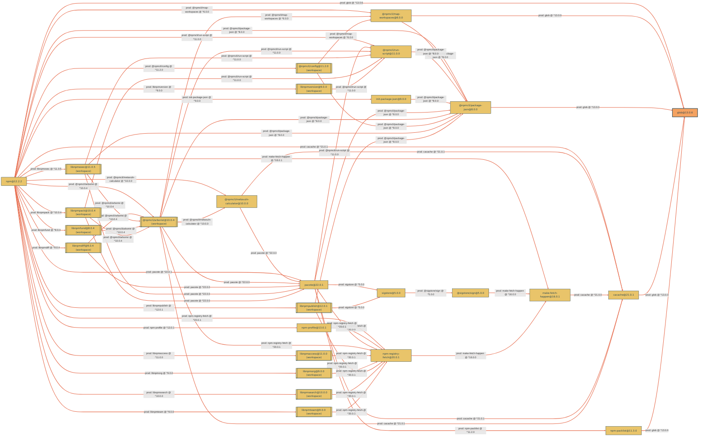

# Dependency graph: npm

- Inputs: package.json, package-lock.json; lockfile version 3.
- Dependency selection: production, optional, and peer dependencies.
- Filters: focus glob; depth unlimited.
- Displayed: 27 nodes, 70 relationships.
- Omitted by filters: 122 nodes, 289 relationships.
- Excluded boundaries: 0 relationships; excluded non-node&#95;modules project records: 0.
- Workspaces: included; reached 12 of 16 workspace projects.
- Focus mode: filter; matching instances: 1.

## Warnings

- optional-not-recorded: node&#95;modules/proxy-agent-negotiate declares optional peer dependency kerberos (^2.0.0), but no eligible package is recorded.

## Legend

- Arrows point from the declaring package to its resolved dependency.
- Node versions are selected versions; edge labels show the dependency role, declared name, and original specification.
- `prod`, `dev`, `optional`, `peer`, and `optional peer` identify dependency roles.
- Unresolved and unrecorded optional dependencies have placeholder nodes.
- Workspace projects use double-bordered (subroutine) nodes labeled `(workspace)`.
- Focus (Sunset Boulevard): coral nodes with thick borders are matches; warm-sand nodes are ancestors; thick burnt-orange arrows trace the ancestor subgraph. Unrelated branches keep their normal style.
- The node index identifies matches and ancestors without relying on color.

## Dependency graph

## Node index

| ID | Name | Selected version | Lockfile location | Focus |
| --- | --- | --- | --- | --- |
| n0 | npm | 12.2.2 | (root) | Ancestor |
| n13 | &#64;npmcli/map-workspaces | 6.0.0 | node&#95;modules/&#64;npmcli/map-workspaces | Ancestor |
| n14 | &#64;npmcli/metavuln-calculator | 10.0.0 | node&#95;modules/&#64;npmcli/metavuln-calculator | Ancestor |
| n17 | &#64;npmcli/package-json | 8.0.0 | node&#95;modules/&#64;npmcli/package-json | Ancestor |
| n21 | &#64;npmcli/run-script | 11.0.0 | node&#95;modules/&#64;npmcli/run-script | Ancestor |
| n25 | &#64;sigstore/sign | 5.0.0 | node&#95;modules/&#64;sigstore/sign | Ancestor |
| n40 | cacache | 21.0.1 | node&#95;modules/cacache | Ancestor |
| n53 | glob | 13.0.6 | node&#95;modules/glob | Match |
| n59 | init-package-json | 9.0.0 | node&#95;modules/init-package-json | Ancestor |
| n69 | make-fetch-happen | 16.0.1 | node&#95;modules/make-fetch-happen | Ancestor |
| n88 | npm-packlist | 11.3.0 | node&#95;modules/npm-packlist | Ancestor |
| n92 | npm-profile | 13.0.1 | node&#95;modules/npm-profile | Ancestor |
| n93 | npm-registry-fetch | 20.0.1 | node&#95;modules/npm-registry-fetch | Ancestor |
| n96 | pacote | 22.0.1 | node&#95;modules/pacote | Ancestor |
| n112 | sigstore | 5.0.0 | node&#95;modules/sigstore | Ancestor |
| n137 | &#64;npmcli/arborist (workspace) | 10.0.4 | workspaces/arborist | Ancestor |
| n138 | &#64;npmcli/config (workspace) | 11.2.0 | workspaces/config | Ancestor |
| n139 | libnpmaccess (workspace) | 11.0.0 | workspaces/libnpmaccess | Ancestor |
| n140 | libnpmdiff (workspace) | 9.0.4 | workspaces/libnpmdiff | Ancestor |
| n141 | libnpmexec (workspace) | 11.0.5 | workspaces/libnpmexec | Ancestor |
| n142 | libnpmfund (workspace) | 8.0.4 | workspaces/libnpmfund | Ancestor |
| n143 | libnpmorg (workspace) | 9.0.0 | workspaces/libnpmorg | Ancestor |
| n144 | libnpmpack (workspace) | 10.0.4 | workspaces/libnpmpack | Ancestor |
| n145 | libnpmpublish (workspace) | 12.0.1 | workspaces/libnpmpublish | Ancestor |
| n146 | libnpmsearch (workspace) | 10.0.0 | workspaces/libnpmsearch | Ancestor |
| n147 | libnpmteam (workspace) | 9.0.0 | workspaces/libnpmteam | Ancestor |
| n148 | libnpmversion (workspace) | 9.0.0 | workspaces/libnpmversion | Ancestor |
